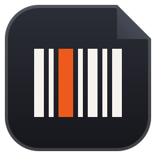
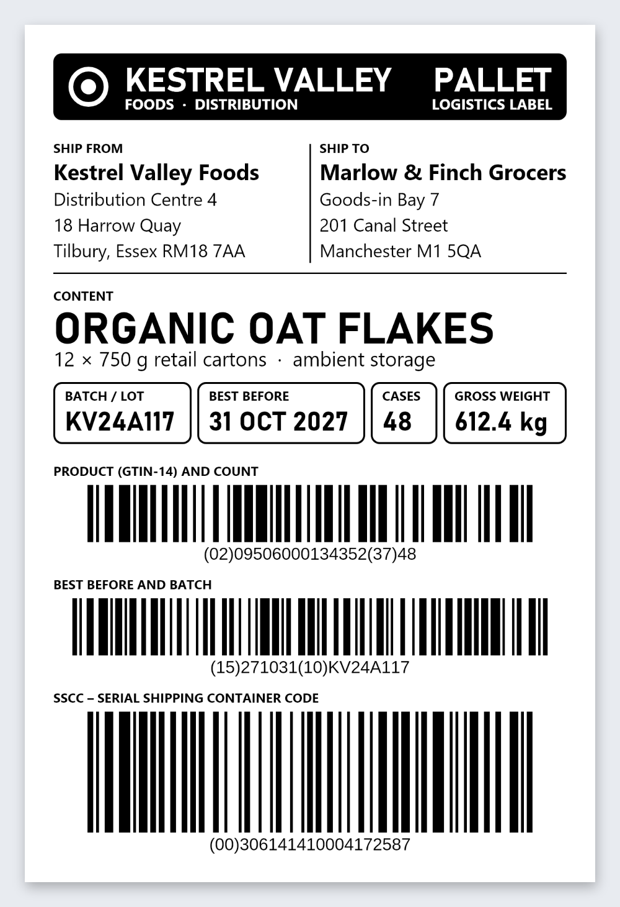
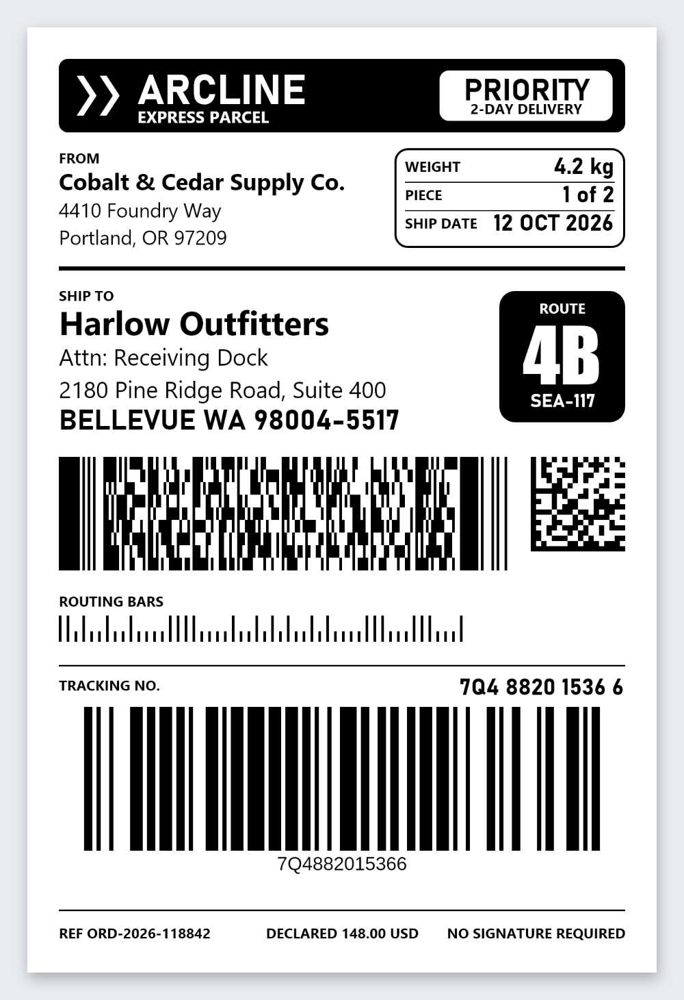
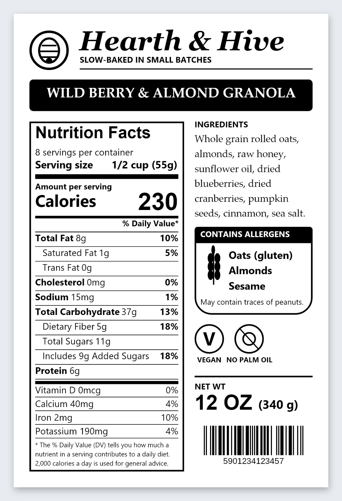
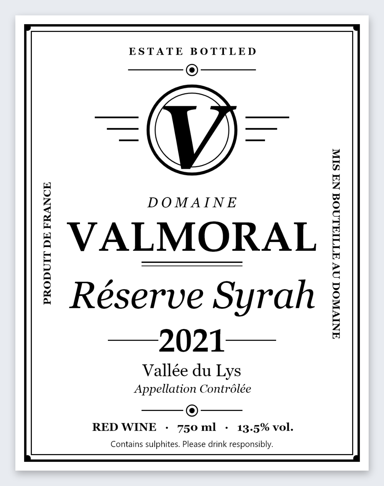
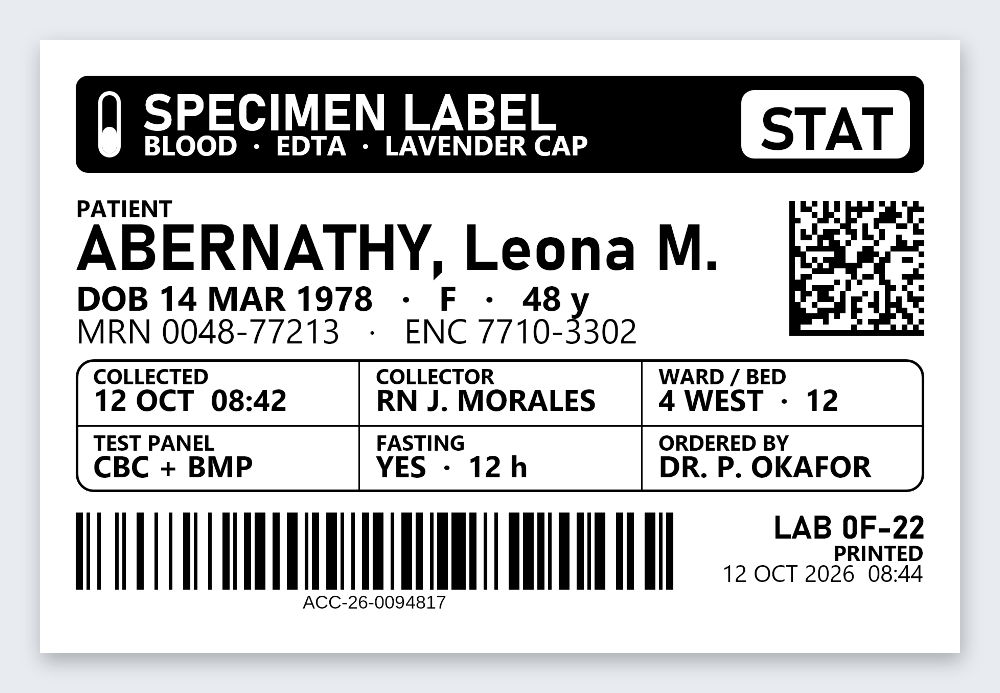
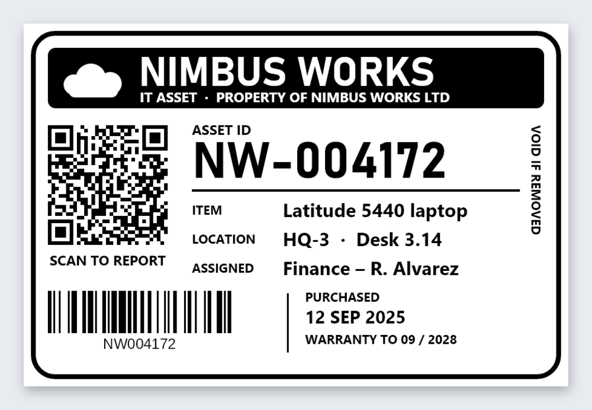
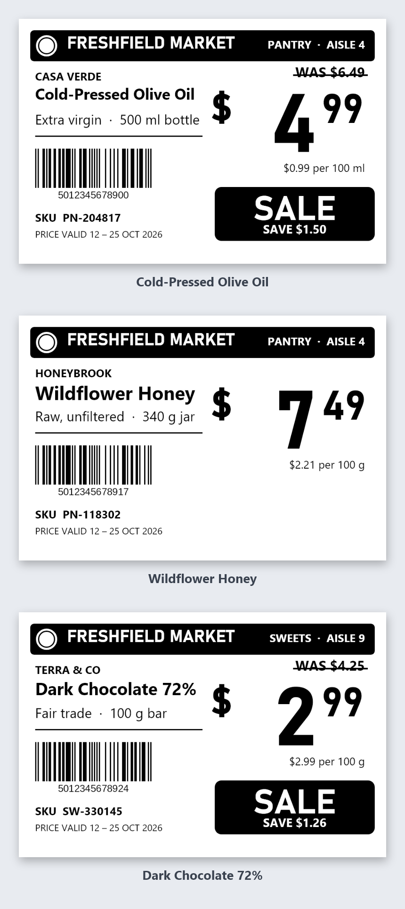
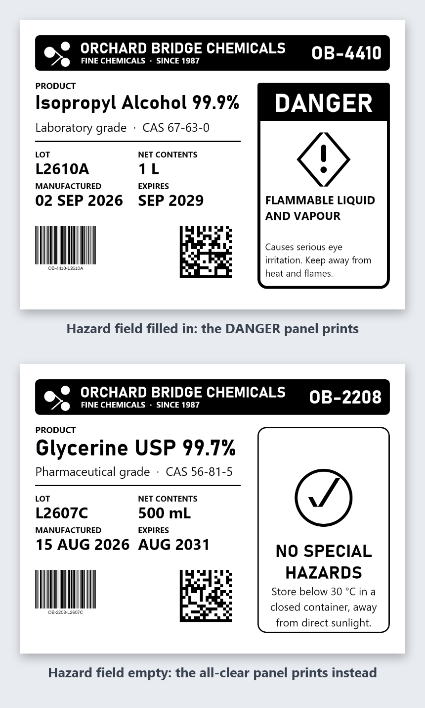
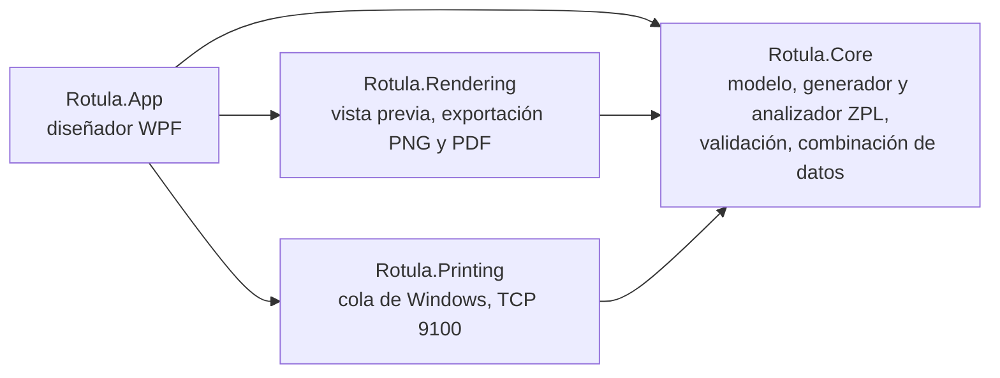

<div align="center">



# Rotula

**Diseñador gratuito de códigos de barras y etiquetas para Windows (ZPL)**

Diséñala, previsualízala, combina tus datos e imprímela. Sin cuenta, sin nube, sin telemetría.

[](https://github.com/P4Software/Rotula/actions/workflows/build.yml)
[](https://github.com/P4Software/Rotula/releases/latest)
[](LICENSE)


[English](README.md) | **Español**

[Descargar](#descargar) ·
[Funciones](#recorrido-de-funciones) ·
[Inicio rápido](#inicio-rápido) ·
[Cobertura ZPL](docs/zpl-coverage.md) ·
[Impresión](docs/printing.md) ·
[Historial de cambios](CHANGELOG.md)


</div>

---

## Contenido

- [Descargar](#descargar)
- [Recorrido de funciones](#recorrido-de-funciones)
- [Galería](#galería)
- [Por qué Rotula](#por-qué-rotula)
- [Inicio rápido](#inicio-rápido)
- [Importar ZPL existente](#importar-zpl-existente)
- [Combinación de datos](#combinación-de-datos)
- [Etiquetas y rollos de la biblioteca](#etiquetas-y-rollos-de-la-biblioteca)
- [Fuentes de bases de datos](#fuentes-de-bases-de-datos)
- [Impresión](#impresión)
- [Puesto de impresión](#puesto-de-impresión)
- [Servidor MCP](#servidor-mcp)
- [Códigos de barras compatibles](#códigos-de-barras-compatibles)
- [Idiomas](#idiomas)
- [Privacidad](#privacidad)
- [Atajos de teclado](#atajos-de-teclado)
- [Requisitos del sistema](#requisitos-del-sistema)
- [Compilar desde el código fuente](#compilar-desde-el-código-fuente)
- [Estructura del proyecto](#estructura-del-proyecto)
- [Contribuir](#contribuir)
- [Seguridad](#seguridad)
- [Hoja de ruta](#hoja-de-ruta)
- [Limitaciones conocidas](#limitaciones-conocidas)
- [Agradecimientos](#agradecimientos)
- [Licencia](#licencia)

---

## Descargar

<div align="center">

### [Descargar el instalador de Rotula para Windows (firmado)](https://github.com/P4Software/Rotula/releases/download/v0.3.5/Rotula-0.3.5-win-x64-setup.exe)

`Rotula-0.3.5-win-x64-setup.exe` · 105 MB · se instala solo para tu usuario, sin permisos de administrador

Siempre la versión más reciente: [github.com/P4Software/Rotula/releases/latest](https://github.com/P4Software/Rotula/releases/latest)

</div>

| Paquete | Archivo | Notas |
|---|---|---|
| **Instalador** | `Rotula-<versión>-win-x64-setup.exe` | Instalación por usuario, acceso en el menú Inicio e icono de escritorio opcional. Firmado digitalmente |
| **Portátil** | `Rotula-<versión>-win-x64-portable.zip` | Descomprime en cualquier carpeta y haz doble clic en `Rotula.App.exe`. No instala nada. No necesita .NET |
| **MSI (para TI)** | `Rotula-<versión>-win-x64.msi` | Instalación para todo el equipo en Archivos de programa, para todos los usuarios, con Intune, directiva de grupo o Configuration Manager. Firmado. Consulta la [instalación en empresas](docs/deployment.md) (en inglés) |
| **winget** | `winget install P4Software.Rotula` | Próximamente. El manifiesto del paquete está preparado, pero aún no fue aceptado en el catálogo de winget |

Para instalar Rotula en toda una organización (instalación silenciosa, el MSI, Intune, configuración por directiva de grupo):
[docs/deployment.md](docs/deployment.md) (en inglés).

Cada versión incluye además un archivo `SHA256SUMS.txt`.

<details>
<summary><b>Verifica tu descarga (suma de comprobación y firma)</b></summary>

**1. Revisa la suma SHA-256.** En PowerShell, dentro de la carpeta donde guardaste el archivo:

```powershell
Get-FileHash .\Rotula-0.3.5-win-x64-setup.exe -Algorithm SHA256
```

El valor debe coincidir con la línea de ese archivo en `SHA256SUMS.txt`, en la página de la versión.

**2. Revisa la firma digital.** Haz clic derecho sobre el instalador, elige **Propiedades**, abre la pestaña **Firmas
digitales**, selecciona la firma y pulsa **Detalles**; o usa PowerShell:

```powershell
Get-AuthenticodeSignature .\Rotula-0.3.5-win-x64-setup.exe | Format-List Status, SignerCertificate, TimeStamperCertificate
```

`Status` debe ser `Valid` y el firmante debe ser **Barrdega Sistemas NA LLC**, con un certificado de sello de tiempo
presente. Tanto el instalador como `Rotula.App.exe` dentro del zip portátil están firmados. Si el estado es otro, no
ejecutes el archivo y [avísanos](SECURITY.md).

</details>

<details>
<summary><b>Sobre la advertencia de Windows SmartScreen</b></summary>

Los instaladores de Rotula están firmados, lo que le indica a Windows quién los publicó y que no fueron alterados. Pero la
firma no otorga reputación inmediata. SmartScreen también considera cuántas personas descargaron un archivo, así que una
versión nueva de un proyecto pequeño puede mostrar "Windows protegió su PC" durante un tiempo, aunque la firma sea válida.

Si la ves, comprueba el nombre del editor que muestra el cuadro, luego elige **Más información** y **Ejecutar de todas
formas**. También puedes comparar la suma de comprobación y la firma como se explica arriba, o
[compilar Rotula desde el código fuente](#compilar-desde-el-código-fuente).

</details>

Las versiones se construyen y firman en un equipo de desarrollo de P4 Software; los pasos están en
[docs/releasing.md](docs/releasing.md) (en inglés). GitHub Actions solo compila y ejecuta las pruebas, y nunca publica
instaladores.

---

## Recorrido de funciones

### Diseña de forma visual

Un lienzo con reglas (milímetros, pulgadas o puntos), cuadrícula, ajuste a la cuadrícula y a otros elementos, selección
múltiple, alineación y distribución, orden de capas, rotación, lista de capas, panel de propiedades, deshacer y rehacer sin
límite, y tema claro. Elementos: texto y bloques de texto con ajuste de línea, campos de datos, códigos de barras, códigos
QR, cuadros, líneas, círculos e imágenes monocromáticas (con umbral o tramado).

<p align="center"></p>

### Vista previa e impresión

La vista previa muestra la etiqueta más grande, tal como se dibujará, y dice con claridad que es aproximada. El cuadro de
impresión lee la resolución y el tamaño de papel desde el controlador de la impresora, puede enviar una etiqueta de prueba
e imprime en una impresora de Windows o en una impresora de red.

<p align="center"></p>

### Combina tus datos

Carga un archivo CSV o Excel, asigna columnas a `{{variables}}`, agrega contadores de números de serie, elige las copias
por registro, revisa cada registro en busca de problemas e imprime todo el lote. El archivo de datos nunca se guarda
dentro de la etiqueta.

<p align="center"></p>

### Lee exactamente lo que recibe la impresora

El panel ZPL muestra el código generado, en vivo y de solo lectura, con un botón Copiar ZPL y un botón Exportar .zpl. La
salida es determinista y en ASCII puro, así que puedes versionarla, compararla o enviarla con cualquier otra herramienta.

<p align="center"></p>

### Todo de un vistazo

| Área | Qué obtienes |
|---|---|
| **Diseñador** | Reglas, cuadrícula, ajuste, guías, selección múltiple, alinear, distribuir, orden de capas, rotación de 90 grados, lista de capas, deshacer/rehacer sin límite |
| **Elementos** | Texto, texto con ajuste de línea, campos de datos, 28 comandos ZPL de códigos de barras, cuadros, líneas, círculos, imágenes |
| **Medios de etiqueta** | Una biblioteca de tamaños con búsqueda por número de parte: escribe un número de parte o un tamaño y obtén el tamaño exacto y los ajustes del medio ([detalles](#etiquetas-y-rollos-de-la-biblioteca)) |
| **Archivos** | Archivos `.rotula` en JSON con versión; el guardado pasa por un archivo temporal, así que un guardado fallido conserva la versión anterior. Se recuerdan los archivos recientes |
| **Exportación** | ZPL, PNG y PDF |
| **Importación ZPL** | Abre archivos `.zpl` existentes, con avisos y paso directo de lo que no entiende ([detalles](#importar-zpl-existente)) |
| **Combinación de datos** | CSV, `.xlsx` y consultas de solo lectura a bases de datos, `{{variables}}`, contadores, copias por registro, lotes |
| **Bases de datos** | SQL Server, PostgreSQL, MySQL/MariaDB, SQLite y ODBC, más ajustes predefinidos para servicios en la nube comunes ([detalles](#fuentes-de-bases-de-datos)) |
| **Cobertura ZPL** | 222 comandos ZPL revisados uno por uno en una [página de cobertura generada](docs/zpl-coverage.md) (en inglés) |
| **Servidor MCP** | Un programa aparte que permite a los clientes compatibles con MCP diseñar y revisar etiquetas ([detalles](#servidor-mcp)) |
| **Impresión** | Cola de Windows (RAW, incluido USB) y puerto TCP 9100, detección de DPI y papel, perfiles de impresora, etiqueta de prueba, comprobación del estado de la impresora antes y después de cada trabajo |
| **Puesto de impresión** | Una pantalla bloqueada, solo para imprimir, pensada para el almacén: elige o escanea una etiqueta, responde a sus preguntas con un lector de códigos, imprime y lee la respuesta de la impresora en letra grande y palabras sencillas ([detalles](#puesto-de-impresión)) |
| **Resolución** | Convierte una etiqueta entre 203, 300 y 600 dpi conservando su tamaño físico |
| **Idiomas** | Español, inglés, portugués (Brasil) y francés (Canadá), con cambio en vivo |

---

## Galería

Etiquetas reales, generadas con la exportación PNG de Rotula a partir de los archivos de [`docs/showcase`](docs/showcase). Ábrelas en Rotula para ver cómo están hechas, o modifica una y guárdala.

<table>
<tr>
<td align="center" valign="top"><br><sub>Palé GS1-128: SSCC, GTIN, lote y fecha de caducidad.</sub></td>
<td align="center" valign="top"><br><sub>Paquete: PDF417, Data Matrix, barras POSTNET y Code 128.</sub></td>
</tr>
<tr>
<td align="center" valign="top"><br><sub>Alimento: tabla nutricional, alérgenos y EAN-13.</sub></td>
<td align="center" valign="top"><br><sub>Vino: fuentes de Windows, texto girado y adornos dibujados.</sub></td>
</tr>
<tr>
<td align="center" valign="top"><br><sub>Muestra de laboratorio a 600 dpi: cabecera inversa, Data Matrix.</sub></td>
<td align="center" valign="top"><br><sub>Activo: código QR, Code 128 y logotipo dibujado con formas.</sub></td>
</tr>
<tr>
<td align="center" valign="top"><br><sub>Estantería: tres registros de datos, banda SALE solo si hay oferta.</sub></td>
<td align="center" valign="top"><br><sub>Condiciones: panel DANGER solo si el campo Hazard tiene valor.</sub></td>
</tr>
</table>

Todas las marcas, direcciones y números son ficticios, y solo se usan fuentes que vienen con Windows. Los códigos de barras son reales: cada uno que un decodificador puede leer se lee de vuelta al generar las imágenes. Los ejemplos de estantería y de peligro incluyen el CSV que los llena, para que puedas repetirlos con la [combinación de datos](#combinación-de-datos).

Para volver a generar las imágenes a partir de los archivos (PowerShell, desde la raíz del repositorio): `$env:ROTULA_RENDER_SHOWCASE=1; dotnet test tests/Rotula.Tests --filter ShowcaseRenderTests`

---

## Por qué Rotula

El software de etiquetas ha significado casi siempre una licencia de pago, una cuenta, una suscripción o un servidor. Rotula
es un único programa de escritorio que hace el trabajo y no estorba.

- **Gratis y con licencia MIT.** Úsalo en casa, en la oficina, en un almacén o dentro de un producto. Sin puestos ni planes.
- **Sin conexión por diseño.** Sin analítica, sin telemetría, sin sincronización en la nube. El único tráfico de red que
  Rotula puede generar es la etiqueta que envías a la dirección de impresora que escribiste, las bases de datos que conectas
  y, solo si la activas, una búsqueda de actualizaciones anónima al día.
- **ZPL honesto.** La misma etiqueta con los mismos datos siempre da ZPL idéntico byte a byte, en ASCII puro.
- **Errores que puedes resolver.** Un dígito verificador EAN-13 inválido o un carácter que no existe en Code 39 se reporta en
  lenguaje sencillo, con lo que debes hacer a continuación.
- **Pensado para lotes.** Una hoja de cálculo se convierte en cientos de etiquetas, con números de serie.
- **Tus archivos son tuyos.** Etiquetas en JSON simple y ZPL en texto plano. Sin cuenta y sin ataduras.

### Cómo se compara

Una mirada neutral a lo que es Rotula frente a las suites comerciales de diseño de etiquetas que muchos equipos ya conocen
(por ejemplo NiceLabel, Zebra Designer y BarTender). Esos productos son maduros y cubren mucho más terreno; esta tabla
trata de en qué se diferencia Rotula, no de quién es mejor.

| | Rotula | Suites comerciales de diseño de etiquetas |
|---|---|---|
| **Precio** | Gratis, licencia MIT | Licencias comerciales; algunas ofrecen una edición gratuita o limitada |
| **Cuenta o activación** | Ninguna | Depende del producto y la edición |
| **Uso de la red** | Ninguno, salvo imprimir a la dirección que indicas | Depende del producto |
| **Código fuente** | Abierto, en GitHub | Propietario |
| **Salida a la impresora** | ZPL (impresoras compatibles con ZPL II) | Normalmente muchos lenguajes y controladores de impresora |
| **Fuentes de datos** | CSV, Excel (`.xlsx`) y consultas de solo lectura a bases de datos | Normalmente también bases de datos, ERP y otras integraciones |
| **Medios de etiqueta** | Biblioteca integrada con búsqueda por número de parte | Depende del producto; algunos traen sus propias bibliotecas |
| **Automatización** | Servidor MCP para clientes compatibles con MCP | Depende del producto |
| **Plataforma** | Windows 10 y 11 | Depende del producto |
| **Alcance** | Un diseñador de escritorio con impresión | A menudo incluyen servidor, flujos de trabajo y administración empresarial |

Si necesitas RFID, escribir de vuelta en bases de datos, administración centralizada, otros lenguajes de impresora o un contrato de soporte del
fabricante, hoy una de esas suites es la mejor opción. Si necesitas diseñar una etiqueta ZPL, combinar una hoja de cálculo e
imprimir, sin instalar una plataforma, Rotula está hecho para eso. Todos los nombres de producto pertenecen a sus
propietarios; Rotula no está afiliado a ellos. "Compatible con ZPL" describe el lenguaje de impresora que Rotula escribe.

---

## Inicio rápido

1. **Instala.** [Descarga](#descargar) el instalador (o descomprime la versión portátil) e inicia Rotula.
2. **Diseña.** Pulsa `Ctrl+N`, elige el tamaño de la etiqueta y la resolución de la impresora, y agrega texto, códigos de
   barras y formas desde la caja de herramientas. Cambia lo que necesites en el panel de propiedades.
3. **Previsualiza.** Pulsa **Vista previa** para ver la etiqueta más grande. Muestra el panel ZPL para leer el código generado.
4. **Imprime.** Pulsa `Ctrl+P`, elige tu impresora (Rotula lee su resolución y tamaño de papel desde el controlador) y
   pulsa primero **Imprimir etiqueta de prueba**.
5. **Imprime la etiqueta.** Indica el número de copias y pulsa **Imprimir**. Para imprimir muchas etiquetas distintas usa
   la [combinación de datos](#combinación-de-datos) (`Ctrl+M`) con una hoja de cálculo.

Escribe `{{sku}}` en cualquier texto o código de barras para convertirlo en una variable de la combinación de datos.

<details>
<summary><b>Cómo se ve la salida</b></summary>

Una etiqueta con marco, un código de barras Code 128 y un código QR, tomada de los archivos de prueba de referencia del proyecto:

```zpl
^XA
^MNY
^MTT
^CI28
^PW800
^LL400
^PON
^LH0,0
^FWN
^CF0,30,30
^FO10,10^GB780,380,3,B,0^FS
^FO30,30^A0,50,40^FDRotula^FS
^FO30,120^BY2,3.0^BC,90,Y,N,N,A^FDSKU-0042^FS
^FO600,30^BQ,2,5^FDQA,SKU-0042^FS
^PQ1,0,1,N
^XZ
```

</details>

---

## Importar ZPL existente

¿Ya tienes etiquetas escritas en ZPL? Usa **Archivo > Importar ZPL** para abrirlas como un diseño editable en lugar de
empezar de cero. Esta es la parte que la mayoría de las herramientas de etiquetas omite, y Rotula la toma en serio.

- **Un analizador real, no una búsqueda de texto.** Rotula lee ZPL II y lo convierte en un diseño: configuración de la
  etiqueta, campos y posicionamiento, bloques de campo, fuentes, cuadros, círculos, campos gráficos (incluidos los datos
  comprimidos) y los 28 comandos ZPL de códigos de barras. El texto se decodifica con el juego de caracteres `^CI`
  vigente en ese punto del archivo.
- **Los patrones de barras se convierten en Code 128.** Cuando un archivo dibuja un código de barras como una fila de barras
  verticales, Rotula reconoce el patrón y puede reemplazarlo por un código de barras Code 128 real y editable.
- **Nada se descarta en silencio.** Los comandos que Rotula no interpreta se conservan tal cual como ZPL sin procesar, así
  que se siguen enviando a la impresora al imprimir o exportar. Todo lo aproximado o no compatible genera un aviso que
  indica la línea.
- **Varias etiquetas en un archivo** se convierten en varios documentos.

Los 222 comandos ZPL, con su estado, están en la [página de cobertura](docs/zpl-coverage.md) (generada, en inglés). Lee las
[limitaciones conocidas](#limitaciones-conocidas) para saber qué no se conserva en un viaje de ida y vuelta.

---

## Combinación de datos

Abre **Impresora > Combinar datos** (`Ctrl+M`). La ventana recorre cinco pestañas:

| Pestaña | Qué hace |
|---|---|
| **Datos** | Abre un archivo CSV o Excel (`.xlsx`); elige la hoja o el delimitador; indica si la primera fila contiene los nombres de columna; previsualiza los registros |
| **Variables** | Cada `{{variable}}` de la etiqueta se llena con la columna del mismo nombre, o con otra columna que elijas |
| **Contadores** | Números de serie: numéricos o de letras y dígitos, con inicio, paso, relleno de ceros, prefijo, sufijo y qué ocurre cuando el contador se agota. Se usan como `{{#Nombre}}` |
| **Copias y trabajos** | Copias por registro: la cantidad propia de la etiqueta, un número para todos o una columna de los datos. Opcionalmente, dividir en trabajos de N registros |
| **Revisar e imprimir** | Encuentra los registros con problemas antes de enviar nada y luego imprime todos los registros válidos |

Recorre los registros con el navegador y ve cada uno en el lienzo. Los datos se quedan en tu PC: en el archivo de la
etiqueta solo se guarda la configuración de la combinación, nunca los datos.

---

## Etiquetas y rollos de la biblioteca

Existen cientos de tamaños de etiqueta. **Archivo > Nuevo** abre un selector: escribe un número de parte del fabricante (o una
parte), un tamaño en casi cualquier forma (`4x6`, `4 x 6 in`, `102x152`, `100x150mm`) o una familia de producto, y la lista se
reduce mientras escribes. Elige un resultado y Rotula ajusta el tamaño de la etiqueta, el tipo de medio (térmico directo o
transferencia térmica) y el seguimiento.

- **Qué sabe.** Tamaño en milímetros y pulgadas, radio de las esquinas, etiquetas a lo ancho, tamaño del núcleo, etiquetas por
  rollo y de dónde sale el dato. Un medio cuyo tamaño no está contrastado aparece marcado y, al aplicarlo, se muestra un aviso.
- **Sin inventar.** La separación entre etiquetas casi siempre se desconoce, así que Rotula indica que calibres la impresora en
  lugar de adivinar. En medios con varias etiquetas por fila o en hojas solo se aplica el tamaño de una etiqueta, y Rotula lo dice.
- **Tus propios medios.** Guarda un tamaño personalizado como medio, o importa una lista de suministros (`.csv` o `.xlsx`) y revisa
  las filas antes de conservarlas. Los precios nunca se leen. Tus medios se guardan en `%AppData%\Rotula\stocks`.
- **Favoritos y recientes** se recuerdan en tu PC.

Las marcas y los nombres de producto pertenecen a sus dueños; Rotula no está afiliado a ellos. Formato del archivo, fuentes y cómo
corregir una entrada: [docs/stock-catalog.md](docs/stock-catalog.md) (en inglés).

---

## Fuentes de bases de datos

En la ventana Combinar datos elige **Base de datos** como origen para llenar etiquetas desde una conexión guardada y una consulta.

- **Motores.** SQL Server, PostgreSQL, MySQL y MariaDB, archivos SQLite y orígenes ODBC. Los ajustes predefinidos completan el puerto
  habitual y la configuración segura de servicios comunes (por ejemplo Amazon RDS y Redshift, Supabase, Neon, Azure SQL, Google Cloud
  SQL, y archivos de Microsoft Access o Excel mediante ODBC).
- **Solo lectura por diseño.** Solo se acepta una instrucción `SELECT`; todo lo que podría cambiar datos, ejecutar código o leer
  archivos se rechaza antes de abrir una conexión. La mejor protección sigue siendo una cuenta de base de datos que solo pueda leer.
- **Las contraseñas** se guardan protegidas por Windows para tu cuenta y nunca se escriben en un archivo de etiqueta. Las conexiones
  van cifradas de forma predeterminada.
- **Complementos.** Otros motores pueden instalarse como complementos aparte. Un complemento es un programa, por eso Rotula pide tu
  aprobación antes de cargar uno de tu propia carpeta.

Guía para desarrolladores: [docs/data-providers.md](docs/data-providers.md) (en inglés).

---

## Impresión

Rotula envía el ZPL como datos RAW, así que el controlador lo transmite sin tocarlo.

| Destino | Úsalo para |
|---|---|
| **Impresora de Windows** | Cualquier cola instalada en Windows, **incluidas las impresoras USB mediante su controlador instalado**. Una impresora apagada se reporta, no se encola en silencio |
| **Impresora de red (TCP 9100)** | Impresoras que escuchan en el puerto sin procesar. Escribe el nombre del host o la dirección IP |

- **Detección de resolución y papel.** Rotula lee la resolución de la impresora (203, 300 o 600 dpi) y el tamaño de papel desde
  el controlador de Windows sin imprimir nada, y ofrece usar el tamaño de papel de la impresora. Si no puede leer un valor,
  lo eliges tú.
- **Conversión automática al DPI de la impresora.** Una etiqueta diseñada a 203 dpi que va a una impresora de 300 dpi se
  convierte automáticamente conservando su tamaño físico, y el cuadro enumera lo que conviene revisar. También puedes cambiar
  el diseño abierto a la resolución de la impresora y deshacerlo con `Ctrl+Z`.
- **Perfiles de impresora.** La resolución, el seguimiento de medios, la oscuridad (0 a 30) y la velocidad (1 a 14) se
  recuerdan junto con la impresora.
- **Etiqueta de prueba.** Una pequeña etiqueta de muestra comprueba la conexión, el ancho y los caracteres con tilde.
- **Estado de la impresora.** Antes de un trabajo Rotula puede preguntar a la impresora su estado (el comando ZPL `~HS`) y
  retener el trabajo mientras no tenga etiquetas, esté abierta, sin cinta, en pausa o demasiado caliente. Después espera a que
  la impresora indique que terminó y dice "impreso y verificado", nombra el fallo o avisa de que no pudo confirmarlo. Viene
  activado para impresoras de red; para una impresora de Windows actívalo en el cuadro Imprimir (muchos controladores USB no
  pueden responder y entonces se imprime sin la comprobación). "Comprobar estado de la impresora" muestra la respuesta cuando
  quieras.
- **Fallos en lenguaje sencillo.** Impresora desconectada, conexión rechazada, host inalcanzable, tiempo agotado o un carácter
  que el juego de caracteres no puede imprimir: cada caso dice qué pasó y qué hacer. Rotula no incluye controladores de impresora.

Más información en [docs/printing.md](docs/printing.md) (en inglés).

---

## Puesto de impresión

Una pantalla solo para imprimir, para operarios, que se abre con `Rotula.exe --station <carpeta>` (o **Archivo > Abrir puesto de
impresión**). Muestra las etiquetas de una carpeta como mosaicos grandes, sin menús ni herramientas de diseño.

- **Elegir o escanear.** Toca un mosaico, escribe parte de su nombre o escanea el código que el puesto asigna a la etiqueta.
- **Pensado para lectores.** Las preguntas de la etiqueta son campos grandes; un lector de códigos de tipo teclado rellena uno y su
  Intro o Tab pasa al siguiente. Con "imprimir al último escaneo" el último escaneo imprime en el acto. Antes se comprueban las
  reglas de la propia etiqueta (obligatorio, longitud, patrón), y un escaneo rechazado se queda en su campo.
- **Resultado claro.** Lista, retenida (por ejemplo "el cabezal está abierto"), impresa y verificada, o sin confirmar, en letra
  grande y palabras sencillas. Después las preguntas se vacían para la siguiente pieza; se pueden conservar las respuestas elegidas.
- **Bloqueado.** Para salir hace falta un PIN cuando se ha definido (solo se guarda un hash con sal). Las impresoras, los límites
  de copias, la impresión de datos y el PIN vienen de un `station.json` junto a las etiquetas o en `%ProgramData%\Rotula`, así que
  el puesto se puede configurar por directiva.

Más información en [docs/print-station.md](docs/print-station.md) (en inglés).

---

## Códigos de barras compatibles

Rotula escribe y lee **28 comandos ZPL de códigos de barras** (lineales, 2D, apilados y postales; la lista completa está en la [página de cobertura](docs/zpl-coverage.md)).
Cada simbología valida sus datos mientras escribes (dígitos verificadores, caracteres permitidos, longitudes). Las más comunes:

| Simbología | Comando ZPL | Uso típico |
|---|---|---|
| Code 128 | `^BC` | Logística, envíos, uso general (modos de subconjunto N, U, A, D) |
| Code 39 | `^B3` | Etiquetas industriales y de inventario |
| Code 93 | `^BA` | Alfanumérico compacto |
| EAN-13 | `^BE` | Productos de venta al detalle |
| UPC-A | `^BU` | Productos de venta al detalle (Norteamérica) |
| Interleaved 2 of 5 | `^B2` | Cajas y logística |
| Código QR | `^BQ` | URL, datos de contacto, cualquier texto |
| Data Matrix | `^BX` | Piezas pequeñas, electrónica |
| PDF417 | `^B7` | Documentos, boletos, cédulas |

---

## Servidor MCP

`Rotula.Mcp.exe` es un programa de consola aparte, no forma parte de la ventana del diseñador. Habla el Protocolo de Contexto de
Modelos (MCP), de modo que los clientes compatibles con MCP pueden crear y editar etiquetas, añadir códigos de barras, validarlos,
previsualizarlos, guardarlos y generar ZPL. No tiene acceso a la red por sí mismo, solo trabaja en las carpetas que permitas y mantiene
**desactivados** la impresión y el acceso a bases de datos hasta que los actives en `rotula-mcp.settings.json`. Imprimir exige una
confirmación en dos pasos. El instalador lo coloca junto a la aplicación, por defecto en
`%LOCALAPPDATA%\Programs\Rotula\Rotula.Mcp.exe`. Instalación, herramientas y ajustes de seguridad: [docs/mcp.md](docs/mcp.md) (en inglés).

---

## Idiomas

La interfaz está disponible en **español**, **inglés**, **portugués (Brasil)** y **francés (Canadá)**. De forma
predeterminada Rotula sigue el idioma de Windows (cualquier portugués usa portugués de Brasil, cualquier francés usa francés
de Canadá, y un idioma que Rotula no tiene usa inglés), y puedes cambiarlo en cualquier momento desde **Ver > Idioma**, sin
reiniciar. Los números y las fechas siguen el idioma elegido. El instalador también está en los cuatro idiomas.

---

## Privacidad

Rotula funciona totalmente sin conexión. No tiene telemetría, ni analítica, ni cuentas, y no hace llamadas de red por su
cuenta. El único tráfico de red que puede generar es la etiqueta que envías a la dirección de impresora de red que indicaste
y las bases de datos a las que te conectas. **Ayuda > Buscar actualizaciones una vez al día** está desactivado hasta que lo
activas: entonces Rotula pregunta a GitHub una vez al día cuál es la versión más reciente (una sola solicitud anónima, no se
envía nada sobre ti ni sobre tu PC) y muestra un enlace cuando hay una más nueva. Nunca descarga ni instala nada. Un
administrador puede activarla o desactivarla para todos ([instalación en empresas](docs/deployment.md), en inglés). Tus preferencias (idioma, unidades, archivos recientes, última impresora) son un pequeño archivo JSON en
`%AppData%\Rotula`. Si el programa falla, escribe un registro en `%AppData%\Rotula\rotula.log` en tu PC y no lo envía a ningún lado.

---

## Atajos de teclado

| Atajo | Acción | Atajo | Acción |
|---|---|---|---|
| `Ctrl+N` | Nueva etiqueta | `Ctrl+O` | Abrir |
| `Ctrl+S` | Guardar | `Ctrl+Shift+S` | Guardar como |
| `Ctrl+P` | Imprimir | `Ctrl+M` | Combinar datos |
| `Ctrl+Z` | Deshacer | `Ctrl+Y` o `Ctrl+Shift+Z` | Rehacer |
| `Ctrl+X` | Cortar | `Ctrl+C` | Copiar |
| `Ctrl+V` | Pegar | `Ctrl+D` | Duplicar |
| `Ctrl+A` | Seleccionar todo | `Supr` | Eliminar |
| `F3` | Seleccionar el elemento siguiente | `Shift+F3` | Seleccionar el elemento anterior |
| `Ctrl+R` | Girar 90 grados a la derecha | `Ctrl+Shift+R` | Girar 90 grados a la izquierda |
| `Ctrl++` | Acercar | `Ctrl+-` | Alejar |
| `Ctrl+0` | Tamaño real (100%) | `Ctrl+9` | Ajustar la etiqueta a la ventana |
| Flechas | Mover 1 punto | `Shift`+flechas | Mover 8 puntos |
| `Esc` | Cancelar un arrastre en curso | `Alt+F4` | Salir |

---

## Requisitos del sistema

- Windows 10 versión 1809 o posterior, o Windows 11, de 64 bits
- No hace falta instalar .NET por separado: las versiones publicadas son autocontenidas
- Para imprimir: una impresora compatible con ZPL, instalada en Windows (USB o red) o accesible por el puerto TCP 9100

---

## Compilar desde el código fuente

Necesitas Windows y el [SDK de .NET 10](https://dotnet.microsoft.com/download/dotnet/10.0).

```
git clone https://github.com/P4Software/Rotula.git
cd Rotula
dotnet build Rotula.sln -c Release
dotnet test  Rotula.sln -c Release
dotnet run --project src/Rotula.App -c Release
```

`Rotula.Core` no tiene interfaz ni código específico de plataforma, y la integración continua exige al menos 80% de
cobertura de líneas sobre ese proyecto. Rotula se prueba con archivos ZPL de referencia y decodificando los códigos de
barras que dibuja. Para generar un instalador firmado, consulta [docs/releasing.md](docs/releasing.md) (en inglés).

---

## Estructura del proyecto



| Ruta | Qué contiene |
|---|---|
| `src/Rotula.Core` | Modelo de etiqueta, generador y analizador ZPL, validación de códigos de barras, combinación de datos. Sin interfaz |
| `src/Rotula.Rendering` | Motor de vista previa con SkiaSharp, dibujo de códigos de barras, exportación PNG y PDF |
| `src/Rotula.Printing` | Impresión por la cola de Windows y por TCP 9100, detección de la impresora |
| `src/Rotula.Data` | Proveedores de bases de datos, ajustes predefinidos, el filtro de consultas de solo lectura y el almacén de conexiones |
| `src/Rotula.Mcp` | El servidor MCP (un ejecutable aparte) |
| `src/Rotula.App` | La aplicación WPF |
| `tests/` | Pruebas xUnit y los archivos ZPL de referencia |
| `packaging/` | Script del instalador, proyecto del MSI, plantillas de directiva de grupo y plantillas del manifiesto de winget |
| `docs/` | [Cobertura ZPL](docs/zpl-coverage.md), [catálogo de medios](docs/stock-catalog.md), [proveedores de datos](docs/data-providers.md), [servidor MCP](docs/mcp.md), [impresión](docs/printing.md), [publicación de versiones](docs/releasing.md), [decisiones de diseño](docs/decisions.md) (en inglés) |

---

## Contribuir

Los reportes de errores, las muestras de ZPL que se importan mal, las traducciones y los pull requests son bienvenidos.
Empieza por [CONTRIBUTING.md](CONTRIBUTING.md) (en inglés) y respeta el [Código de conducta](CODE_OF_CONDUCT.md). Los cambios
se registran en [CHANGELOG.md](CHANGELOG.md).

## Seguridad

Reporta las vulnerabilidades en privado, no en un issue público. Los pasos están en [SECURITY.md](SECURITY.md) (en inglés).

---

## Hoja de ruta

No es compatible hoy, y está abierto a discusión:

- Salida EPL, TSPL y CPCL
- Codificación RFID
- Escribir en bases de datos (las consultas son de solo lectura por diseño)
- Un mercado de plantillas de etiquetas
- Sincronización en la nube
- macOS y Linux
- Diseños de hojas con varias etiquetas

¿Tienes un caso de uso que te importa? [Abre una solicitud de función](https://github.com/P4Software/Rotula/issues/new/choose).

---

## Limitaciones conocidas

Léelas antes de depender de Rotula para etiquetas de producción, e **imprime siempre primero una etiqueta de prueba**.

- **La vista previa es aproximada.** El texto se dibuja con una tipografía sustituta incluida en el programa, no con las
  fuentes de la impresora, así que la forma de las letras y los saltos de línea pueden diferir un poco de la etiqueta
  impresa. La aplicación lo avisa.
- **Fuentes de mapa de bits y `FontWidth`.** Las fuentes de mapa de bits integradas de la impresora no se reproducen; el
  escalado de ancho solo se aproxima en la vista previa.
- **`^PO` (orientación de impresión) no se previsualiza.** Se escribe en el ZPL, pero la vista previa siempre muestra la
  orientación normal.
- **Las variables no sobreviven a un viaje de ida y vuelta por ZPL.** ZPL no puede expresar `{{nombre}}`, así que el ZPL
  importado es texto simple hasta que lo edites.
- **El ZPL sin procesar no se escala al convertir el DPI.** Los comandos desconocidos conservados como ZPL sin procesar
  mantienen sus puntos originales cuando una etiqueta se convierte a otra resolución, y Rotula te avisa.
- **Los comandos no compatibles** (consulta [la página de cobertura](docs/zpl-coverage.md)) se conservan como ZPL sin
  procesar cuando es posible, pero no se interpretan ni se previsualizan.
- Rotula se prueba con decodificadores y archivos de referencia, no con todos los modelos de impresora.
- Solo salida ZPL, y solo Windows.

---

## Agradecimientos

Rotula se apoya en [SkiaSharp](https://github.com/mono/SkiaSharp), [ZXing.Net](https://github.com/micjahn/ZXing.Net),
[MiniExcel](https://github.com/mini-software/MiniExcel), [CommunityToolkit.Mvvm](https://github.com/CommunityToolkit/dotnet)
y las fuentes Liberation. Las versiones y los textos de licencia están en [THIRD-PARTY-NOTICES.md](THIRD-PARTY-NOTICES.md).

## Licencia

[MIT](LICENSE). Copyright (c) 2026 P4 Software.

<div align="center">

Creado por [P4 Software](https://p4software.cloud) en Ciudad de Panamá.

</div>
