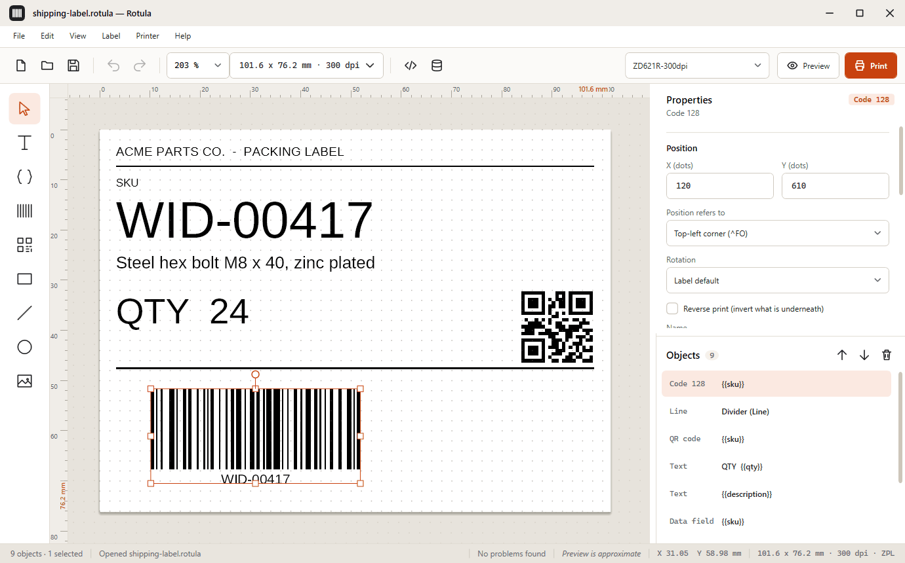
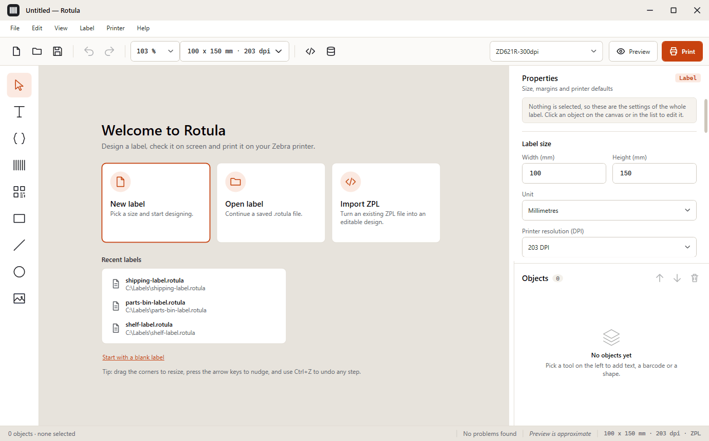
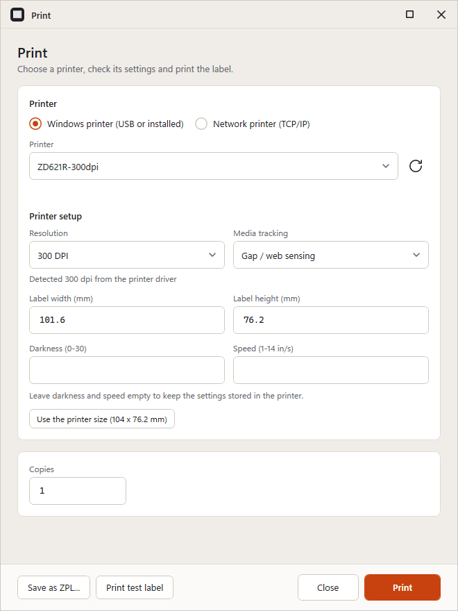
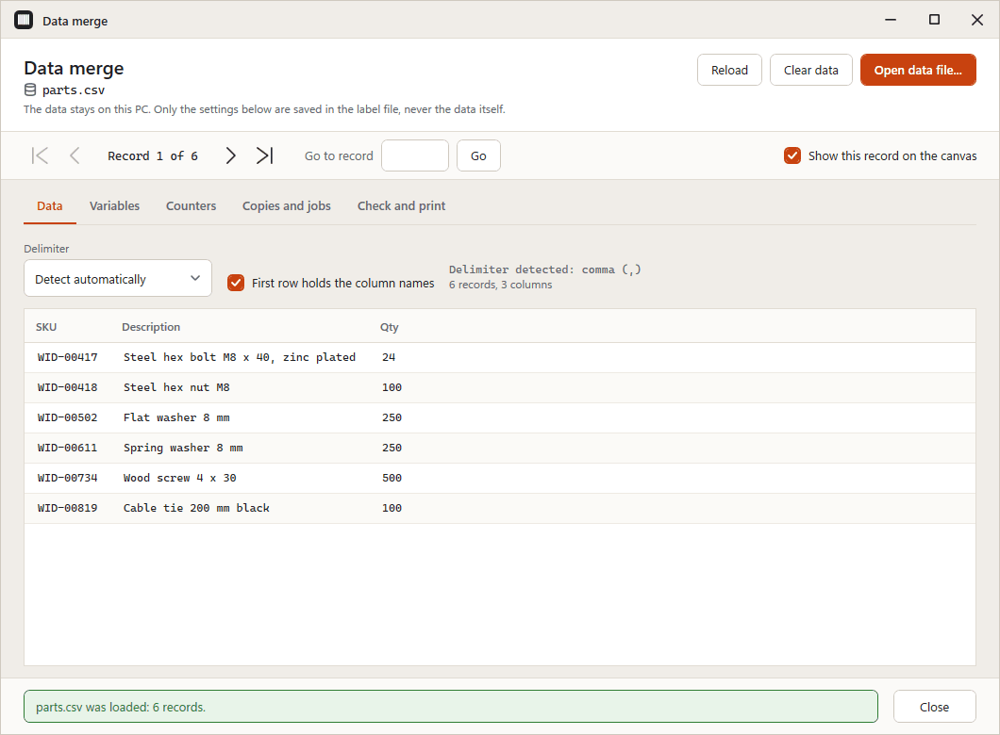
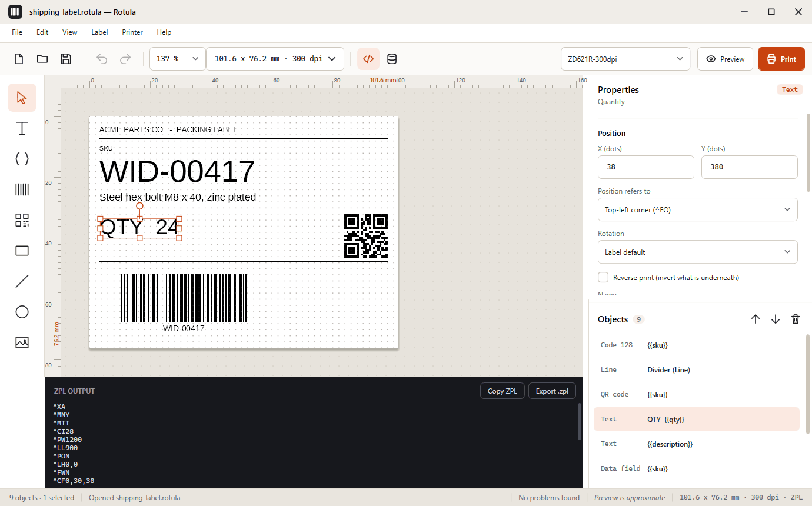
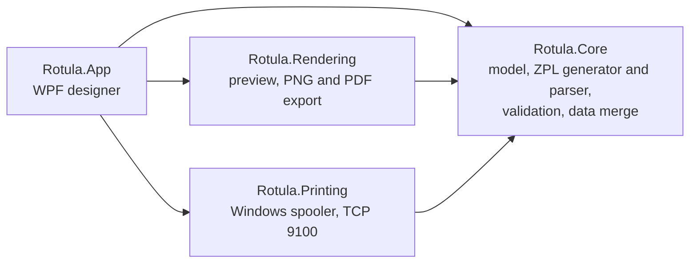

<div align="center">

# Rotula

**Free barcode & label designer for Windows (ZPL)**

Design it, preview it, merge your data, print it. No account, no cloud, no telemetry.

[](https://github.com/P4Software/Rotula/actions/workflows/build.yml)
[](https://github.com/P4Software/Rotula/releases/latest)
[](LICENSE)


**English** | [Español](README.es.md)

[Download](#download) ·
[Features](#feature-tour) ·
[Quick start](#quick-start) ·
[ZPL support](docs/zpl-support.md) ·
[Printing](docs/printing.md) ·
[Changelog](CHANGELOG.md)



</div>

---

## Contents

- [Download](#download)
- [Feature tour](#feature-tour)
- [Why Rotula](#why-rotula)
- [Quick start](#quick-start)
- [Import existing ZPL](#import-existing-zpl)
- [Data merge](#data-merge)
- [Printing](#printing)
- [Barcode support](#barcode-support)
- [Languages](#languages)
- [Privacy](#privacy)
- [Keyboard shortcuts](#keyboard-shortcuts)
- [System requirements](#system-requirements)
- [Building from source](#building-from-source)
- [Project layout](#project-layout)
- [Contributing](#contributing)
- [Security](#security)
- [Roadmap](#roadmap)
- [Known limitations](#known-limitations)
- [Acknowledgements](#acknowledgements)
- [License](#license)

---

## Download

<div align="center">

### [Download the Rotula installer for Windows (signed)](https://github.com/P4Software/Rotula/releases/download/v0.1.0/Rotula-0.1.0-win-x64-setup.exe)

`Rotula-0.1.0-win-x64-setup.exe` · installs for your user only, no administrator rights needed

Always the newest version: [github.com/P4Software/Rotula/releases/latest](https://github.com/P4Software/Rotula/releases/latest)

</div>

| Package | File | Notes |
|---|---|---|
| **Installer** | `Rotula-<version>-win-x64-setup.exe` | Per-user install, Start menu entry, optional desktop icon. Code-signed |
| **Portable** | `Rotula-<version>-win-x64-portable.zip` | Unzip anywhere and double-click `Rotula.App.exe`. Nothing is installed. No .NET needed |
| **winget** | `winget install P4Software.Rotula` | Coming soon. The package manifest is prepared but not yet accepted into the winget catalog |

Every release also carries a `SHA256SUMS.txt` file.

<details>
<summary><b>Verify your download (checksum and signature)</b></summary>

**1. Check the SHA-256 checksum.** In PowerShell, in the folder where you saved the file:

```powershell
Get-FileHash .\Rotula-0.1.0-win-x64-setup.exe -Algorithm SHA256
```

The hash must match the line for that file in `SHA256SUMS.txt` on the release page.

**2. Check the digital signature.** Either right-click the installer, choose **Properties**, open the **Digital
Signatures** tab, select the signature and click **Details**; or use PowerShell:

```powershell
Get-AuthenticodeSignature .\Rotula-0.1.0-win-x64-setup.exe | Format-List Status, SignerCertificate, TimeStamperCertificate
```

`Status` should be `Valid` and the signer should be **Barrdega Sistemas NA LLC**, with a timestamp certificate present. The
installer and `Rotula.App.exe` inside the portable zip are both signed. If the status is anything else, do not run the file
and [tell us](SECURITY.md).

</details>

<details>
<summary><b>About the Windows SmartScreen warning</b></summary>

Rotula installers are signed, which tells Windows who published them and that they were not altered. Signing does not give
instant reputation, though. SmartScreen also looks at how many people have downloaded a file, so a new release of a small
project can still show "Windows protected your PC" for a while, even when the signature is valid.

If you see it, check the publisher name shown on the dialog, then choose **More info** and **Run anyway**. You can also
compare the checksum and signature as described above, or [build Rotula from source](#building-from-source).

</details>

Releases are built and signed on a P4 Software developer machine; the steps are in [docs/releasing.md](docs/releasing.md).
GitHub Actions only builds and tests, and never publishes installers.

---

## Feature tour

### Design visually

A canvas with rulers (millimetres, inches or dots), grid, snapping to the grid and to other elements, multi-selection,
align and distribute, z-order, rotation, layers list, a property panel, unlimited undo and redo, and a light theme. Elements:
text and wrapped text blocks, data fields, barcodes, QR codes, boxes, lines, circles and monochrome images (with threshold or
dithering).

<p align="center"></p>

### Preview and print

A live preview shows the label larger, as it will be drawn, and says plainly that it is approximate. The print dialog
reads the resolution and paper size from the printer driver, can send a test label, and prints to a Windows printer or a
network printer.

<p align="center"></p>

### Merge your data

Load a CSV or Excel file, map columns to `{{variables}}`, add serial-number counters, choose the copies per record, check
every record for problems and print the whole batch. The data file itself is never stored in the label.

<p align="center"></p>

### Read exactly what the printer receives

The ZPL panel shows the generated code, live, read-only, with a Copy button and an Export .zpl button. The output is
deterministic and plain ASCII, so you can version it, diff it or send it with any other tool.

<p align="center"></p>

### Everything at a glance

| Area | What you get |
|---|---|
| **Designer** | Rulers, grid, snapping, guides, multi-select, align, distribute, z-order, 90 degree rotation, layers, unlimited undo/redo |
| **Elements** | Text, wrapped text, data fields, 9 barcode symbologies, boxes, lines, circles, images |
| **Files** | Versioned `.rotula` JSON files; saving goes through a temporary file, so a failed save keeps the previous version. Recent files are remembered |
| **Export** | ZPL, PNG and PDF |
| **ZPL import** | Opens existing `.zpl` files, with warnings and raw passthrough ([details](#import-existing-zpl)) |
| **Data merge** | CSV and `.xlsx`, `{{variables}}`, counters, copies per record, batches |
| **Printing** | Windows spooler (RAW, including USB) and TCP port 9100, DPI and paper detection, printer profiles, test label |
| **Resolution** | Convert a label between 203, 300 and 600 dpi while keeping its physical size |
| **Languages** | English and Spanish, switchable live |

---

## Why Rotula

Label software has long meant a paid license, an account, a subscription or a server. Rotula is one desktop program that
does the job and stays out of the way.

- **Free and MIT licensed.** Use it at home, at work, in a warehouse or inside a product. No seats, no tiers.
- **Offline by design.** No analytics, no update checks, no cloud sync. The only network traffic Rotula can produce is the
  label you send to the printer address you typed.
- **Honest ZPL.** The same label and data always give byte-identical ZPL, in plain ASCII.
- **Errors you can act on.** An invalid EAN-13 check digit or a Code 39 character that does not exist is reported in plain
  language, with what to do next.
- **Made for batches.** A spreadsheet becomes hundreds of labels, with serial numbers.
- **Your files stay yours.** Plain JSON labels and plain-text ZPL. No account, no lock-in.

### How it compares

A neutral look at what Rotula is, next to the commercial label design suites many teams already know (for example NiceLabel,
Zebra Designer and BarTender). Those products are mature and cover much more ground; this table is about where Rotula
differs, not about who is better.

| | Rotula | Commercial label design suites |
|---|---|---|
| **Price** | Free, MIT license | Commercial licenses; some offer a free or limited edition |
| **Account or activation** | None | Varies by product and edition |
| **Network use** | None, except printing to the address you enter | Varies by product |
| **Source code** | Open, on GitHub | Proprietary |
| **Printer output** | ZPL (ZPL II compatible printers) | Typically many printer languages and drivers |
| **Data sources** | CSV and Excel (`.xlsx`) | Typically databases, ERP and other integrations as well |
| **Platform** | Windows 10 and 11 | Varies by product |
| **Scope** | One desktop designer and printer | Often include server, workflow and enterprise management features |

If you need databases, RFID, central management, other printer languages or a vendor support contract, one of those suites
is the better fit today. If you need to design a ZPL label, merge a spreadsheet and print, without installing a
platform, Rotula is made for that. All product names belong to their owners; Rotula is not affiliated with them. "ZPL
compatible" describes the printer language Rotula writes.

---

## Quick start

1. **Install.** [Download](#download) the installer (or unzip the portable build) and start Rotula.
2. **Design.** Press `Ctrl+N`, choose the label size and printer resolution, then add text, barcodes and shapes from the
   toolbox. Change anything in the property panel.
3. **Preview.** Click **Preview** to see the label larger. Show the ZPL panel to read the generated code.
4. **Print.** Press `Ctrl+P`, choose your printer (Rotula reads its resolution and paper size from the driver) and click
   **Print test label** first.
5. **Print the label.** Set the number of copies and click **Print**. To print many different labels, use
   [Data merge](#data-merge) (`Ctrl+M`) with a spreadsheet.

Type `{{sku}}` in any text or barcode to make it a variable for data merge.

<details>
<summary><b>What the output looks like</b></summary>

A boxed label with a Code 128 barcode and a QR code, taken from the project's golden test files:

```zpl
^XA
^MNY
^MTT
^CI28
^PW800
^LL400
^PON
^LH0,0
^FWN
^CF0,30,30
^FO10,10^GB780,380,3,B,0^FS
^FO30,30^A0,50,40^FDRotula^FS
^FO30,120^BY2,3.0^BC,90,Y,N,N,A^FDSKU-0042^FS
^FO600,30^BQ,2,5^FDQA,SKU-0042^FS
^PQ1,0,1,N
^XZ
```

</details>

---

## Import existing ZPL

Already have labels written in ZPL? Use **File > Import ZPL** to open them as an editable design instead of starting over.
This is the part most label tools skip, and Rotula takes it seriously.

- **A real parser, not a text search.** Rotula reads ZPL II into a design: label setup, fields and typesetting, field
  blocks, fonts, boxes, circles, graphic fields (including compressed data) and the nine barcode symbologies. Text is decoded
  with the `^CI` character set active at that point in the file.
- **Bar patterns become Code 128.** When a file draws a barcode as a row of vertical bars, Rotula recognizes the pattern and
  can replace it with a real, editable Code 128 barcode.
- **Nothing is dropped silently.** Commands Rotula does not interpret are kept verbatim as raw ZPL, so they are still sent
  to the printer when you print or export. Anything approximated or unsupported produces a warning that names the line.
- **Several labels in one file** become several documents.

The command-by-command matrix is in [docs/zpl-support.md](docs/zpl-support.md). Read [Known limitations](#known-limitations)
for what a round trip does not preserve.

---

## Data merge

Open **Printer > Data merge** (`Ctrl+M`). The window walks through five tabs:

| Tab | What it does |
|---|---|
| **Data** | Open a CSV or Excel (`.xlsx`) file; pick the worksheet or delimiter; say whether the first row holds the column names; preview the records |
| **Variables** | Each `{{variable}}` in the label is filled from the column of the same name, or from another column you choose |
| **Counters** | Serial numbers: numeric or letters-and-digits, with start, step, zero padding, prefix, suffix and what happens when the counter runs out. Use them as `{{#Name}}` |
| **Copies and jobs** | Copies per record: the label's own quantity, one number for all, or a column of the data. Optionally split into jobs of N records |
| **Check and print** | Find the records that have problems before anything is sent, then print every valid record |

Step through the records with the navigator and see each one on the canvas. The data stays on your PC: only the merge
settings are saved in the label file, never the data.

---

## Printing

Rotula sends ZPL as RAW data, so the driver passes it through untouched.

| Target | Use it for |
|---|---|
| **Windows printer** | Any queue installed in Windows, **including USB printers through their installed driver**. A printer that is switched off is reported, not silently queued |
| **Network printer (TCP 9100)** | Printers that listen on the raw port. Enter the host or IP address |

- **Resolution and paper detection.** Rotula reads the printer's resolution (203, 300 or 600 dpi) and paper size from the
  Windows driver without printing anything, and offers to use the printer's paper size. If it cannot read a value, you choose it.
- **Automatic conversion to the printer's DPI.** A label designed at 203 dpi that goes to a 300 dpi printer is converted
  automatically, keeping its physical size, and the dialog lists anything that needs a second look. You can also switch the
  open design to the printer's resolution and undo it with `Ctrl+Z`.
- **Printer profiles.** Resolution, media tracking, darkness (0 to 30) and speed (1 to 14) are remembered with the printer.
- **Test label.** A small sample label checks the connection, the width and accented characters.
- **Plain-language failures.** Offline, refused connection, unreachable host, timeout or a character the character set
  cannot print: each says what happened and what to do. Rotula bundles no printer drivers.

More in [docs/printing.md](docs/printing.md).

---

## Barcode support

Each symbology validates its data as you type (check digits, allowed characters, lengths).

| Symbology | ZPL command | Typical use |
|---|---|---|
| Code 128 | `^BC` | Logistics, shipping, general purpose (subset modes N, U, A, D) |
| Code 39 | `^B3` | Industrial and inventory labels |
| Code 93 | `^BA` | Compact alphanumeric |
| EAN-13 | `^BE` | Retail products |
| UPC-A | `^BU` | Retail products (North America) |
| Interleaved 2 of 5 | `^B2` | Cartons and logistics |
| QR Code | `^BQ` | URLs, contact data, any text |
| Data Matrix | `^BX` | Small parts, electronics |
| PDF417 | `^B7` | Documents, tickets, ID cards |

---

## Languages

The interface is available in **English** and **Spanish**. By default Rotula follows the Windows language, and you can
switch at any time from **View > Language**, with no restart. The installer is also available in both languages.

---

## Privacy

Rotula works fully offline. It has no telemetry, no analytics, no update checks, no account and makes no network calls. The
only network traffic it can produce is the label you send to the network printer address you entered. Your settings
(language, units, recent files, last printer) are a small JSON file in `%AppData%\Rotula`. If the program ever fails, it
writes a log to `%AppData%\Rotula\rotula.log` on your PC and sends it nowhere.

---

## Keyboard shortcuts

| Shortcut | Action | Shortcut | Action |
|---|---|---|---|
| `Ctrl+N` | New label | `Ctrl+O` | Open |
| `Ctrl+S` | Save | `Ctrl+Shift+S` | Save as |
| `Ctrl+P` | Print | `Ctrl+M` | Data merge |
| `Ctrl+Z` | Undo | `Ctrl+Y` or `Ctrl+Shift+Z` | Redo |
| `Ctrl+X` | Cut | `Ctrl+C` | Copy |
| `Ctrl+V` | Paste | `Ctrl+D` | Duplicate |
| `Ctrl+A` | Select all | `Del` | Delete |
| `F3` | Select next element | `Shift+F3` | Select previous element |
| `Ctrl+R` | Rotate 90 degrees clockwise | `Ctrl+Shift+R` | Rotate 90 degrees counter-clockwise |
| `Ctrl++` | Zoom in | `Ctrl+-` | Zoom out |
| `Ctrl+0` | Actual size (100%) | `Ctrl+9` | Fit label in window |
| Arrow keys | Nudge by 1 dot | `Shift`+Arrow keys | Nudge by 8 dots |
| `Esc` | Cancel a drag in progress | `Alt+F4` | Exit |

---

## System requirements

- Windows 10 version 1809 or later, or Windows 11, 64-bit
- No separate .NET install: the release builds are self-contained
- For printing: a ZPL-compatible printer, installed in Windows (USB or network) or reachable on TCP port 9100

---

## Building from source

You need Windows and the [.NET 10 SDK](https://dotnet.microsoft.com/download/dotnet/10.0).

```
git clone https://github.com/P4Software/Rotula.git
cd Rotula
dotnet build Rotula.sln -c Release
dotnet test  Rotula.sln -c Release
dotnet run --project src/Rotula.App -c Release
```

`Rotula.Core` has no UI and no platform code, and CI enforces at least 80% line coverage on it. Rotula is tested against
golden ZPL files and by decoding the barcodes it renders. To produce a signed installer, see
[docs/releasing.md](docs/releasing.md).

---

## Project layout



| Path | What lives there |
|---|---|
| `src/Rotula.Core` | Label model, ZPL generator and parser, barcode validation, data merge. No UI |
| `src/Rotula.Rendering` | SkiaSharp preview renderer, barcode drawing, PNG and PDF export |
| `src/Rotula.Printing` | Windows spooler and TCP 9100 printing, printer detection |
| `src/Rotula.App` | The WPF application |
| `tests/` | xUnit tests and the golden ZPL fixtures |
| `packaging/` | Installer script and winget manifest templates |
| `docs/` | [ZPL support](docs/zpl-support.md), [printing](docs/printing.md), [releasing](docs/releasing.md), [design decisions](docs/decisions.md) |

---

## Contributing

Bug reports, ZPL samples that import badly, translations and pull requests are welcome. Start with
[CONTRIBUTING.md](CONTRIBUTING.md) and follow the [Code of Conduct](CODE_OF_CONDUCT.md). Changes are tracked in
[CHANGELOG.md](CHANGELOG.md).

## Security

Please report vulnerabilities privately, not in a public issue. The steps are in [SECURITY.md](SECURITY.md).

---

## Roadmap

Not supported today, and open for discussion:

- EPL, TSPL and CPCL output
- RFID encoding
- Database connections (CSV and Excel only for now)
- A label template marketplace
- Cloud sync
- macOS and Linux
- Multi-label sheet layouts

Have a use case that matters to you? [Open a feature request](https://github.com/P4Software/Rotula/issues/new/choose).

---

## Known limitations

Read these before relying on Rotula for production labels, and **always print a test label first**.

- **The preview is approximate.** Text is drawn with a bundled stand-in typeface, not the printer's own fonts, so letter
  shapes and line breaks can differ slightly from the printed label. The app says so.
- **Bitmap fonts and `FontWidth`.** The printer's built-in bitmap fonts are not reproduced; width scaling is only approximated
  in the preview.
- **`^PO` (print orientation) is not previewed.** It is written to the ZPL, but the preview always shows the normal orientation.
- **Variables do not survive a ZPL round trip.** ZPL cannot express `{{name}}`, so imported ZPL is plain text until you edit it.
- **Raw ZPL is not scaled on DPI conversion.** Unknown commands kept as raw ZPL stay in their original dots when a label is
  converted to another resolution, and Rotula warns you.
- **Unsupported commands** (see [the support matrix](docs/zpl-support.md)) are kept as raw ZPL where possible but are not
  interpreted or previewed.
- Rotula is tested against decoders and golden files, not against every printer model.
- ZPL output only, and Windows only.

---

## Acknowledgements

Rotula stands on [SkiaSharp](https://github.com/mono/SkiaSharp), [ZXing.Net](https://github.com/micjahn/ZXing.Net),
[MiniExcel](https://github.com/mini-software/MiniExcel), [CommunityToolkit.Mvvm](https://github.com/CommunityToolkit/dotnet)
and the Liberation fonts. Versions and license texts are in [THIRD-PARTY-NOTICES.md](THIRD-PARTY-NOTICES.md).

## License

[MIT](LICENSE). Copyright (c) 2026 P4 Software.

<div align="center">

Built by [P4 Software](https://p4software.cloud) in Panama City.

</div>
